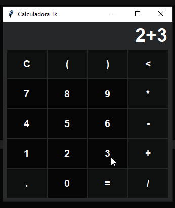

<div align='center'>
    <h1>Calculadora Tk</h1>
    
</div>

## Motivación
El proyecto tiene como objetivo incentivar a principiantes en programación con Python a contribuir en proyectos open source que vayan más allá de la terminal, de modo que el desarrollo sea más visual.

Por lo tanto, se creó Calculadora Tk con funcionalidades matemáticas básicas y algunos errores intencionales para que las correcciones y ampliaciones de nuevas funcionalidades sean realizadas por el público objetivo (principiantes).

## Cómo contribuir
Siga los pasos a continuación:

1. Haga un `Fork` del proyecto [Calculadora Tk](<https://github.com/matheusfelipeog/calculadora-tk.git>) en la esquina superior derecha de la pantalla;
2. Clone el proyecto desde su repositorio en GitHub (`git clone https://github.com/SU_USUARIO/calculadora-tk.git`);
3. Cree una branch para realizar su modificación (`git checkout -b feature/nombre_de_la_modificacion`);
4. Después de realizar sus modificaciones, haga un `commit` (`git commit -m "Descripción de la modificación"`);
5. Haga `Push` a su repositorio (`git push origin feature/nombre_modificacion`);
6. En su repositorio de *GitHub*, cree una `Pull Request` para que sus modificaciones sean evaluadas y luego integradas (`merge`) al proyecto principal.

## Colaboradores

| [<br /><sub>@aguiarcandre</sub>](https://github.com/aguiarcandre) | [<br /><sub>@carlos3g</sub>](https://github.com/carlos3g) | [<br /><sub>@ericllma</sub>](https://github.com/ericllma) | [<br /><sub>@sam-chami</sub>](https://github.com/sam-chami) | [<br /><sub>@taisbferreira</sub>](https://github.com/taisbferreira) | [<br /><sub>@edilsonmatola</sub>](https://github.com/edilsonmatola) | 
|:-:|:-:|:-:|:-:|:-:|:-:|
| [<br /><sub>@maguzzz</sub>](https://github.com/maguzzz) | [<br /><sub>@vinayyak</sub>](https://github.com/vinayyak) |

## Ideas/Bugs
Si encuentra algún bug, cree una `issue` describiendo el problema encontrado e informando el paso a paso para reproducirlo.

Y si tiene alguna idea de nueva funcionalidad que pueda ser implementada por otros principiantes, cree una `issue` describiendo esa idea. ;)

## Inicio
```bash
$ python main.py
```

o cree su propio archivo con el siguiente script y luego siga el procedimiento anterior con el nombre correspondiente:

```Python
# -*- coding: utf-8 -*-

# Builtin
import tkinter as tk

# Internal module
from app.calculadora import Calculadora

if __name__ == '__main__':
    master = tk.Tk()
    main = Calculadora(master)
    main.start()
```

## Guías
- Tkinter: [Documentación](https://docs.python.org/3/library/tkinter.html) - *Existen varias otras guías mostradas al inicio de la página*
- Git y GitHub: [Tutorial en Tableless](https://tableless.com.br/tudo-que-voce-queria-saber-sobre-git-e-github-mas-tinha-vergonha-de-perguntar/) - *Lectura*
- Git y GitHub: [Tutorial en YouTube](https://www.youtube.com/playlist?list=PLQCmSnNFVYnRdgxOC_ufH58NxlmM6VYd1) - *Video tutorial*
- Pull Request en GitHub: [Tutorial DigitalOcean](https://www.digitalocean.com/community/tutorials/como-criar-um-pull-request-no-github-pt) - *Lectura*